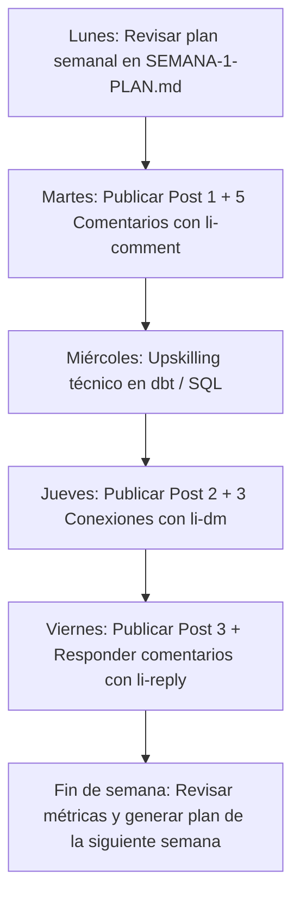

# 🚀 LinkedIn Command Center & Career Growth Hub

> Sistema integral de posicionamiento profesional, creación de contenido técnico de alta autoridad y roadmap de preparación hacia roles de **Senior Data Analyst**, **Analytics Engineer** y **Applied AI Specialist**.

**Propietario:** Eduardo Tejada Reyes  
**Credenciales:** Ingeniero de Sistemas Colegiado (CIP: 372629) | 1er Puesto de Promoción (UPN) | Maestría en Inteligencia Artificial (UNIR - En curso)  
**Enfoque:** Ciclo de vida del dato (Python, SQL Server, PostgreSQL, Power BI, Azure) y Machine Learning Aplicado a Negocio.

---

## 🗂️ Arquitectura del Repositorio

| Archivo / Carpeta | Descripción |
| :--- | :--- |
| **[`LINKEDIN-PLAYBOOK.md`](./LINKEDIN-PLAYBOOK.md)** | Manual operativo con toda la suite de skills y comandos para interactuar con agentes de IA. |
| **[`ROADMAP-CARRERA.md`](./ROADMAP-CARRERA.md)** | Plan técnico paso a paso (Modern Data Stack, dbt, SQL avanzado, ML de negocio) y estrategia de caza de empleo. |
| **[`SEMANA-1-PLAN.md`](./SEMANA-1-PLAN.md)** | Plan de acción semanal con las 3 publicaciones redactadas y listas para publicar, más la lista objetivo de networking. |
| **[`voice.md`](./voice.md)** | Calibración de voz y estilo personal (técnico, riguroso, pragmático, sin rodeos ni slop de IA). |
| **[`about-me.md`](./about-me.md)** | Perfil profesional, pilares temáticos, propuesta de valor y audiencia objetivo. |
| **[`tools/`](./tools/)** | Herramientas autónomas en Python ejecutables en local sin dependencias externas. |

---

## 🛠️ Herramientas CLI Incluidas (`tools/`)

Este repositorio incluye herramientas offline en Python (estándar library, sin `pip install` necesario) que puedes ejecutar desde cualquier terminal:

### 1. Limpiador y Detector Anti-IA (`humanize.py` y `detect.py`)
Elimina marcas mecánicas de IA (caracteres invisibles Unicode, *em-dashes*, palabras cliché del diccionario `slop.json`) y calcula una puntuación de detección de 5 factores:

```bash
# Limpiar un borrador y ver el reporte de cambios
python tools/humanize.py mi_post.txt --report

# Evaluar el puntaje de detección (0 a 100)
python tools/detect.py mi_post.txt

# Comparar un antes y después
python tools/detect.py antes.txt despues.txt
```

### 2. Base de Datos de 21 Fórmulas de Ganchos (`hooks.json`)
Catálogo estructurado con 21 fórmulas probadas de apertura de alta retención (*Contrarian Take, Number Reveal, Mistake Confession, Before/After, etc.*), con plantillas y trampas a evitar.

---

## 📋 Flujo de Trabajo Semanal Recomendado



---

## 🌐 Acceso desde Cualquier Dispositivo

Para clonar y trabajar con este centro de comando en cualquier máquina:

```bash
git clone https://github.com/eduardotejada99/linkedin-command-center.git
cd linkedin-command-center
```

Las instrucciones y perfiles son compatibles tanto con Antigravity IDE como con Claude Code, Cursor o cualquier terminal estándar.
